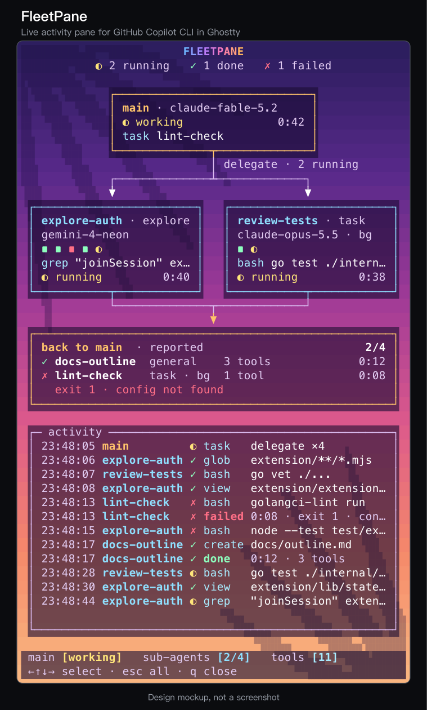

English | [简体中文](README_zh.md)

# FleetPane

FleetPane is a terminal activity pane for GitHub Copilot CLI. Run `copilot` in Ghostty as usual: when you submit the first prompt, the current tab splits and a pane shows the main agent, its sub-agents (for example those started by `/fleet`), their tool calls and an activity log, live.



Design mockup, not a screenshot

## What it does and does not do

What it is:

- A Copilot CLI extension and nothing else. Everything it installs is in `~/.copilot/extensions/fleetpane/`: the extension (Node), an AppleScript that drives Ghostty, and the pane program (a Go TUI). It is not a `copilot plugin` marketplace plugin.
- A read-only observer. It listens to the session's events. It registers no tools and no hooks, does not change prompts, inject context, send messages or take permission decisions. Because it registers no hooks, the CLI does not ask for elevated permissions when it loads. The pane is read-only too: you cannot control agents from it.
- One visible addition to Copilot: the slash command `/fleetpane`.
- It does not change the CLI's configuration. It never writes `~/.copilot/settings.json` and does not touch the CLI, other extensions or plugins.
- It keeps no history by default. What the pane shows lives in the memory of the extension process and is gone when the session ends. The one exception is the debug log at level 2, which you turn on yourself (see [Troubleshooting](#troubleshooting)).

What it does not do:

- Other terminals, running inside tmux, Linux, Windows.
- `copilot -p` (non-interactive) runs: no pane.
- Backfilling earlier events after a session is resumed or the extension is reloaded: the pane starts empty.
- A floating or corner pane; remembering a ratio you set by dragging the divider.
- Background shells (`/tasks` lists them, the pane shows agents only), token usage and cost, a real progress percentage (boxes show a trail of tool calls instead).
- A bell or system notification when an agent waits for you; collapsing the pane after a period of inactivity.
- Image backgrounds in themes.
- A version check between the extension and the pane program.

## Requirements

- macOS on Apple Silicon
- Ghostty 1.4.0 or later, with AppleScript support enabled (`macos-applescript = true`, the default)
- GitHub Copilot CLI with experimental features turned on (see below). Tested with Copilot CLI 1.0.115 (full acceptance) and 1.0.116 (install and smoke test)
- Go 1.26.1 or later, to build from source or to build an install package. Installing from a package needs no Go

The CLI updates itself and FleetPane is not pinned to a CLI version; its behaviour was checked against the versions above. The extension runs on the Node runtime bundled with the CLI, so Node.js is needed only for development.

There is no CI and no published release: build from source, or build an install package with `make dist` and copy it to the machines that need it.

## Install

### From source

```sh
git clone https://github.com/biohazard-requiem/copilot-fleetpane.git
cd copilot-fleetpane
make install
```

`make install` builds `bin/fleetpane` and copies the extension to `~/.copilot/extensions/fleetpane/` (`$COPILOT_HOME/extensions/fleetpane/` if `COPILOT_HOME` is set):

```
~/.copilot/extensions/fleetpane/
├── extension.mjs
├── ghostty-split.applescript
├── lib/*.mjs
├── bin/fleetpane
├── themes/        custom themes; example.json is copied on the first install
└── config.json    created the first time /fleetpane changes a setting
```

Run it again to upgrade, then start a new Copilot session. `config.json` and files already in `themes/` are not overwritten. The binary is replaced atomically, so a pane that is running keeps working.

### From a package

`make dist` builds `dist/fleetpane-<version>-darwin-arm64.tar.gz`: for example `make dist VERSION=0.1.0`; without `VERSION` the version is `dev`. The package holds what a first `make install` puts in place, plus the licence, in one top-level directory `fleetpane/`. The machine it is installed on needs neither Go nor the repository:

```sh
mkdir -p ~/.copilot/extensions
tar -xzf fleetpane-0.1.0-darwin-arm64.tar.gz -C ~/.copilot/extensions
```

That creates `~/.copilot/extensions/fleetpane/`. If `COPILOT_HOME` is set, extract into `$COPILOT_HOME/extensions` instead. Then enable experimental features (next section) and start a new Copilot session.

- To upgrade, extract the new package the same way. `config.json` and your own theme files are kept; `themes/example.json` is replaced. With `tar --safe-writes -xzf …` each file is replaced atomically, as `make install` does, and a pane that is running keeps working.
- The binary is not notarized. A package downloaded with a browser carries macOS's quarantine attribute, `tar` passes it on to the files it extracts, and macOS can then refuse to run the binary, in which case the pane does not open. Remove the attribute from the binary: `xattr -d com.apple.quarantine ~/.copilot/extensions/fleetpane/bin/fleetpane`. A package copied with `scp` or fetched with `curl` does not carry it.

## Enable experimental features (once)

```sh
copilot config experimental on
```

The CLI loads extensions only when experimental features are on. This is a global CLI setting and it also turns on the CLI's other preview features. To turn it off again:

```sh
copilot config experimental off
```

FleetPane never changes this setting, neither on install nor on uninstall.

## Check that it is loaded

Start a new Copilot session and run `/extensions manage`. The list should contain `fleetpane`. The same screen disables or enables the whole extension.

## Usage

Run `copilot` in Ghostty as usual.

- After start there is one pane. When you submit the first prompt, the current tab splits (to the right, 33% by default) and the pane appears. Keyboard focus stays in the Copilot pane.
- The split is made in the tab that runs this Copilot session, also when that tab is in the background or Ghostty is not the frontmost application. The selected tab and the frontmost window do not change.
- Later prompts reuse the same pane.
- A new turn starts with a prompt submitted while the agent is idle (`/fleet …` included), or with a queued prompt at the moment it starts to run. A message you send while the agent is working (steering) belongs to the current turn. `/fleetpane` itself does not start a turn.
- If you close the pane by hand, it stays closed for the rest of the turn: background events and steering messages do not bring it back. It reopens when the next turn starts.
- If the window is too small (the pane would have fewer than 24 columns or 6 rows), the pane is not opened and nothing is printed. This is checked again at the start of every turn. A pane that fits but is small shows a compact list instead of the workflow diagram.
- When Copilot exits or the extension is reloaded, the pane closes.
- Opening the pane runs in the background and does not hold up Copilot. If it fails twice in a row, FleetPane stops opening the pane in that session and prints one warning in the timeline; `/fleetpane on` tries again.
- Outside Ghostty, on other platforms and in `copilot -p` runs, FleetPane does nothing and prints nothing.

## Keys and mouse

Keys go to the pane only while it has keyboard focus. Focus stays in the Copilot pane when the pane opens, so move it first: click the pane, or use Ghostty's shortcut for moving between splits.

| Key | Action |
| --- | --- |
| `tab` / `shift+tab`, `down` / `up`, `j` / `k`, `right` / `left`, `l` / `h` | Select the next / previous item: `main`, the running sub-agents, the entries in `back to main`. While an item is selected, `activity` shows only its records |
| `esc` | Clear the selection; `activity` shows everything again. In the compact layout it first returns from the activity page |
| `enter` | Compact layout only: open the activity page of the selected item. With nothing selected it selects the first item |
| `pgup` / `pgdown` | Scroll `activity` by a page |
| `end` | Jump to the newest record and follow new ones again |
| `q`, `ctrl+c` | Close the pane |

| Mouse | Action |
| --- | --- |
| Wheel | Scrolls the frame under the pointer: the running area, `back to main`, `activity` or the compact list. The selection does not change |
| Left click | Selects what is under the pointer: the `main` box, a sub-agent's box or row, an entry in `back to main` |

- The pane captures the mouse. To select text in it by dragging, hold Shift (with Ghostty's default `mouse-shift-capture = false`).
- Clicking the pane moves keyboard focus to it; Ghostty does this for any split. To return to Copilot, click its pane or use Ghostty's shortcut for moving between splits. To look around without moving focus, use the wheel.
- The wheel also works on the pane while keyboard focus is elsewhere, and it does not move focus.
- The pane ignores keys and mouse events for the first 500 ms after it starts. A key typed at the moment the split appears can land in the new pane, and it should not close it.

## Switches and layout

| Command | Effect | Output |
| --- | --- | --- |
| `/fleetpane`, `/fleetpane status` | Nothing is saved | `FleetPane: on · layout right 33% · theme gta6 · pane open` and the usage line. The last part is `pane open`, `pane closed` or `disabled (<reason>)`; `· this session: hidden` or `· this session: shown` is added when `hide` or `show` is in effect |
| `/fleetpane on` | Saves `enabled: true` for all sessions. Clears this session's `hide` / `show` and a disabled state. Opens the pane now unless it is open or opening | `FleetPane: on · layout right 33% · theme gta6` |
| `/fleetpane off` | Saves `enabled: false` for all sessions. Clears this session's `hide` / `show`. Closes the pane now | `FleetPane: off` |
| `/fleetpane hide` | This session only, not saved to the configuration. Closes the pane now; this session no longer opens it | `FleetPane: hidden in this session` |
| `/fleetpane show` | This session only, not saved to the configuration. Opens the pane now, also when the global switch is off; this session keeps opening it on every turn | `FleetPane: shown in this session` |
| `/fleetpane layout` | Nothing is saved | The current layout and the usage line |
| `/fleetpane layout <right\|left\|top\|bottom> [10-80]` | Saves the layout. An open pane is closed and reopened with the new layout | `FleetPane: layout top 33%` |
| `/fleetpane theme` | Nothing is saved | The current theme and the available themes |
| `/fleetpane theme <name>` | Saves the theme. The pane changes at once, without reopening | `FleetPane: theme auto` |
| `/fleetpane help` | Nothing is saved | The usage line |

```
Usage: /fleetpane on|off|hide|show|layout <right|left|top|bottom> [10-80]|theme [name]|status|help
```

- The size is the pane's share of the Copilot pane before the split, in percent: of its columns for `right` / `left`, of its rows for `top` / `bottom`. A trailing `%` is accepted. Without a size the current one is kept. The number is rounded first and must then be between 10 and 80 (so `9.9` is accepted as 10); otherwise, or when it is not a number, the command is an error and nothing is saved.
- When `on` or `show` starts to open the pane and the window is too small, the answer is `FleetPane: window too small (pane would be <columns>x<rows>, needs 24x6)`. The switch is saved all the same.
- The output is shown in the timeline and is not stored in the session's history.
- `on` / `off`, the layout and the theme are one configuration shared by all sessions. In the other sessions a changed switch or theme takes effect when their next turn starts; a changed layout is used the next time their pane opens, and a pane that is already open stays where it is.
- Every `/fleetpane` command, the ones that only show something included, re-reads the configuration first. If the switch was turned off in another session, the pane in this session closes at that point.
- `hide` / `show` belong to one session and are not written to the configuration. They survive `/clear`, and running `on` or `off` in that session clears them.

The four switches, from the outside in:

| Level | How | Effect |
| --- | --- | --- |
| CLI prerequisite | `copilot config experimental on` / `off` | Whether the CLI loads extensions at all |
| The whole extension | Disable `fleetpane` in `/extensions manage` | The extension is not loaded and `/fleetpane` is gone |
| Opening the pane | `/fleetpane off` / `/fleetpane on` | The extension stays loaded and does not open the pane. Shared by all sessions |
| This session | `/fleetpane hide` / `/fleetpane show` | This session only. `show` overrides `off` |

### Configuration file

`~/.copilot/extensions/fleetpane/config.json`, created the first time `/fleetpane` changes a setting:

```json
{
  "enabled": true,
  "layout": {
    "position": "right",
    "size": 33
  },
  "theme": "gta6"
}
```

| Field | Values | Default | If invalid |
| --- | --- | --- | --- |
| `enabled` | boolean | `true` | `true` |
| `layout.position` | `right`, `left`, `top`, `bottom` | `right` | The default |
| `layout.size` | Integer from 10 to 80 | `33` | Not a number: the default. Out of range: the nearest limit. Fractions are rounded |
| `theme` | `auto`, `gta6` or the name of a custom theme | `gta6` | The default, when it is not a valid theme name |

A missing file or invalid JSON means all defaults. Unknown fields are ignored and not kept when the file is saved. The file is read again at the start of every turn and on every `/fleetpane` command, so you can also edit it by hand.

### The divider

The configured ratio is applied once, when the pane opens. After that you can drag the divider: the pane redraws for its new size and FleetPane does not move the divider back. The ratio you dragged to is not remembered; the next open uses the configured one. Ghostty itself keeps a split between 10% and 90%.

## Themes

Two themes are built in:

- `gta6` (the default) paints the whole pane: a sunset gradient from deep purple to orange, palm silhouettes in two corners, and boxes on a darkened background.
- `auto` paints no background and takes every colour from the terminal: the default foreground, the faint attribute for secondary text, and ANSI palette colours for the rest. It follows the terminal's theme, and it checks the terminal's background every 2 seconds to choose between its colour sets for dark and light backgrounds.

`/fleetpane theme <name>` switches at once; `/fleetpane theme` lists what is available.

`gta6` is an original colour theme inspired by that palette. It is not affiliated with the rights holder of the game and contains no game assets: no logo, no wordmark, no artwork. The silhouettes are generic palm fronds drawn by an algorithm.

### Custom themes

Put a file `<name>.json` in `~/.copilot/extensions/fleetpane/themes/`. The file name is the theme name: 1 to 32 characters from `a-z`, `0-9`, `-` and `_`, starting with a letter or a digit. `auto` and `gta6` always mean the built-in themes. The install puts `example.json` there:

```json
{
  "colors": {
    "fg": "#e6edf3", "dim": "#8b949e", "edge": "#3d444d", "main": "#bc8cff", "agent": "#58a6ff",
    "run": "#d29922", "ok": "#3fb950", "fail": "#f85149", "tool": "#79c0ff", "live": "#58a6ff"
  },
  "title": ["#58a6ff", "#bc8cff"],
  "background": { "stops": ["#0d1117", "#161b22"] },
  "glass": { "color": "#010409", "alpha": 0.5 },
  "decor": "none"
}
```

| Colour | Used for |
| --- | --- |
| `fg` | Body text |
| `dim` | Secondary text: types, times, labels, hints |
| `edge` | Borders and connectors that are neither selected nor active |
| `main` | The main agent's name and box, the merge line, `back to main` |
| `agent` | Names and boxes of running sub-agents, sub-agent names in `activity` |
| `run`, `ok`, `fail` | Icons and status text for running, succeeded, failed |
| `tool` | Tool names |
| `live` | Active connectors, arrows and the moving dot |

A colour is written as `"#rrggbb"`, `"ansi:N"` (N from 0 to 15, from the terminal's palette), `"default"` (the terminal's default foreground) or `"faint"` (the default foreground with the faint attribute).

| Rule | Detail |
| --- | --- |
| Every field is optional | A colour that is missing takes the value of the `auto` theme and, like `auto`, changes with a dark or light terminal. Colours written in the file are used as they are |
| No `background` | No background is painted and the theme follows the terminal, like `auto`. `glass` and `decor` then have no effect |
| `background.stops` | One or more `#rrggbb` colours, top to bottom. With a background, write every colour as `#rrggbb`; otherwise readability is not guaranteed |
| `glass` | The tint behind boxes, the activity frame and the status bar: a colour and an `alpha` from 0 to 1. With a background and no `glass`: `#000000`, 0.5 |
| `decor` | `"none"` (the default), `"palms"`, or `{ "kind": "palms", "color": "#rrggbb", "alpha": 0.3 }` with `alpha` from 0 to 1. Fields left out take the values of `gta6`: `#190b38`, 0.30 |
| `title` | One colour, or an array of colours for a gradient. The default is the `main` colour |
| File | A regular file (not a symbolic link) of at most 64 KiB |
| Errors | Invalid JSON, a wrong colour notation or a wrong field type: the theme is not used. The pane falls back to `gta6` and says why at the end of the status bar, for example `theme <name> not found` |
| Not supported | Background images |

The extension checks only the form of a theme name, not whether the theme exists: `/fleetpane theme <name>` saves the name, and the pane reports a theme it cannot load as described above.

## What the pane shows

| Area | Content |
| --- | --- |
| Title and counts | `FLEETPANE`, then the counts for this turn's sub-agents: `◐ N running  ✓ N done  ✗ N failed`, with `! N waiting` when some wait for you and `⊘ N cancelled` when some were cancelled. Without sub-agents: `no sub-agents this turn` |
| `main` box | The main agent: `main · <model>`, its status and elapsed time, and the current or latest tool |
| Running area | The sub-agents that are running right now, one box each: name and type, the model (with `· bg` for a background sub-agent), a trail of tool calls, the current or latest tool, status and elapsed time. In the trail each finished call is a `■`, coloured by success or failure, and the running call is a spinner |
| `back to main` | The sub-agents that ended in this turn, one line each: status, name, type, number of tool calls, elapsed time. A failed one has a second line with the error. The header counts `ended/total` |
| `activity` | The activity log, newest at the bottom: time, who, status, tool name and a short summary. It keeps the latest 200 records. With an item selected it shows only that item's records |
| Status bar | `main [status]  sub-agents [running/total this turn]  tools [tool calls this turn]`, and the key hints |

- "This turn's sub-agents" are the ones running now plus the ones that ended during this turn. A background sub-agent started in an earlier turn and still running counts as well.
- When a sub-agent ends, its box leaves the running area and its result is listed in `back to main`. That list is cleared when a new turn starts; a steering message does not clear it. Older results remain in `activity` only.
- A sub-agent started by another sub-agent is placed right after its parent and marked with `↳`. Where there is room the parent's name is written out (`↳ <parent>` or `<child> ‹ <parent>`). Selecting the child highlights the parent, and the frame title becomes `activity · <child> ‹ <parent>`.
- Elapsed time is written `m:ss`, or `h:mm:ss` from one hour on.

Status icons:

| Icon | Meaning |
| --- | --- |
| `◐ ◓ ◑ ◒` (spinner) | Running, working |
| `!` | Waiting for you |
| `✓` | Done, succeeded |
| `✗` | Failed |
| `⊘` | Cancelled |
| `○` | Idle |
| `?` | Unknown status |

### Waiting for you

When an agent stops and waits for you, its box shows `!` and one of two texts until you respond:

- `needs approval`: the agent asks you to approve a plan.
- `needs answer`: the agent asked you a question, or an MCP server asks you for input.

A waiting sub-agent stays in the running area and is counted under `! N waiting`. When the main agent waits, the status bar says `main [waiting]`. A request for input from an MCP server is not tied to a tool call; it is shown on `main` unless the event names a sub-agent.

The permission prompt for a tool call is not part of this; see [Known limitations](#known-limitations).

### Layouts

The layout follows the pane's actual size, not the configured position:

| Pane size | Layout |
| --- | --- |
| At least 30 rows and 40 columns | Vertical workflow: `main`, running area, `back to main`, `activity`, top to bottom |
| Otherwise, at least 14 rows and 147 columns | Horizontal workflow: the same, left to right |
| Anything else | Compact list: one line per item. `enter` opens the selected item's activity page, `esc` returns |

For example, in a 170×45 window a `right 33%` pane is about 57×45 and gets the vertical workflow; a `bottom 33%` pane is about 170×15 and gets the horizontal one.

### Many sub-agents

The number of running sub-agents is not limited. None is dropped or folded into a `+N`; each one stays visible and selectable. The running area uses the first form that fits all of them:

1. Full boxes
2. Short boxes, without the second line and the tool trail (vertical workflow only)
3. Compact rows: a frame titled `running · N` with one row per sub-agent
4. Compact rows with scrolling

`activity` is always shown. The running area, `back to main`, `activity` and the compact list scroll when they do not fit; `▲ N` and `▼ N` on the frame's edges count what is hidden above and below. In a 57×45 pane with nothing in `back to main` yet, up to 6 running sub-agents get full boxes, 7 or 8 get short boxes, 9 to 40 get compact rows, and more than that scroll.

## First-run macOS Automation permission

FleetPane controls Ghostty through `osascript`. macOS may ask whether to allow control of Ghostty the first time. No prompt appeared during testing; it is not known whether the permission had been granted earlier or whether none is needed.

If macOS refuses, FleetPane prints one warning and stays off for that session:

```
FleetPane: macOS did not allow control of Ghostty. Allow it in System Settings → Privacy & Security → Automation, then run /fleetpane on.
```

Copilot keeps working while a prompt is pending. The split runs in the background and is given up after 20 seconds.

## Closing the pane

| How | Effect |
| --- | --- |
| `q` or `ctrl+c` in the pane | Closes at once, without confirmation. The pane stays closed for the rest of the turn and reopens when the next turn starts |
| Ghostty's own close action on the pane (`close_surface`, for example its keyboard shortcut) | Ghostty asks `Close Terminal?` because a process is still running in the pane (with its default `confirm-close-surface = true`). After you confirm, the same as `q`, except that FleetPane learns about it about 5 seconds later (see [Known limitations](#known-limitations)) |
| `/fleetpane hide` | Closes the pane. This session does not open it again until `show`, `on` or `off` |
| `/fleetpane off` | Closes the pane. No session opens it until `on`, except a session in which you run `show`. Other sessions notice at the start of their next turn |
| Disabling `fleetpane` in `/extensions manage` | The extension is stopped and the pane closes with it. `/fleetpane` is gone until the extension is enabled again |
| `/exit`, or anything else that ends or reloads the extension | The pane closes with the extension |

Ghostty keeps a pane that was created with a command open after the command exits, until a key is pressed. The pane program therefore closes its own split before it exits. If the pane program is killed before it can do so, the extension closes the split; if the extension is gone as well, an empty pane is left behind and any key closes it.

## How it works

```
Copilot CLI (tty X)
     ^
     |  JSON-RPC over stdio
     v
extension.mjs  ----  osascript ghostty-split.applescript  ---->  Ghostty
(Node, child process of the CLI)                                    |
     |                                             splits the terminal whose tty is X
     |  Unix socket                                and runs fleetpane in the new pane
     |  (the extension is the server)                               |
     |                                                              v
     +----------------------------------->  fleetpane (Go TUI, socket client)
```

The extension joins the session and folds its events into a small state: the main agent, the sub-agents, their tool calls and the activity log. When a turn starts it finds Copilot's TTY among its parent processes, starts listening on a Unix socket of its own, and runs an AppleScript that tells Ghostty to split the terminal with that TTY, run `fleetpane` in the new pane and hand focus back. `fleetpane` connects to the socket and draws every snapshot it receives: one JSON line per complete snapshot, at most one every 50 ms. Ghostty always splits in half, so the extension then measures the Copilot pane and moves the divider to the configured ratio.

The extension is the server so that the pane cannot outlive it: however the extension process ends, the connection drops, and `fleetpane` closes its split and exits. Each session has its own extension process and its own socket, so sessions do not see each other's data.

Where the data lives:

- What the pane shows is only in the memory of the extension process. It is gone when the session ends, and no history is written, unless you set `FLEETPANE_DEBUG=2`: then every snapshot goes into the debug log.
- The history that is kept has limits: 200 activity records, 20 tool calls per agent, and 50 sub-agents that ended in earlier turns. Sub-agents that are running are all kept.
- A snapshot carries names, statuses, times, a short summary of each tool call (a command, a path, a URL) and the first line of an error, never a tool's result.

On disk there are only three things:

| File | Exists | Removed |
| --- | --- | --- |
| `config.json` in the extension directory | Once `/fleetpane` has changed a setting | On uninstall |
| The socket and this session's `hide` / `show` marker, in the runtime directory | While the pane is opening or open; after `hide` or `show` | The socket when the pane closes or the extension process exits. A socket that was left behind, and the marker of a Copilot process that no longer exists, by the next extension that starts or by `make uninstall` |
| The debug log, in the runtime directory | Only with `FLEETPANE_DEBUG` set; each file stops at about 20 MiB | Once the process that wrote it is gone, by the next extension that starts or by `make uninstall` |

The runtime directory is `/tmp/fleetpane-<uid>/`, readable by its owner only.

## Troubleshooting

When the pane does not appear, check in this order:

1. The environment. FleetPane opens a pane only on macOS, in Ghostty, outside tmux, in an interactive session. Anywhere else it stays silent on purpose.
2. Experimental features: run `copilot config experimental on`, then start a new session.
3. The extension: `/extensions manage` lists `fleetpane`, and it is not disabled. If `/fleetpane` is not a known command, the extension is not loaded.
4. The switches: run `/fleetpane` and read the first line. `off`, `this session: hidden` and `disabled (<reason>)` each explain a missing pane; `/fleetpane on` clears all three and tries to open the pane.

   | Reason | Meaning |
   | --- | --- |
   | `not-interactive` | A `copilot -p` run |
   | `unsupported-platform` | Not macOS |
   | `unsupported-terminal` | `TERM_PROGRAM` is set and is not `ghostty` |
   | `no-tty` | Copilot's terminal could not be found |
   | `not-running`, `not-found` | Ghostty is not running, or has no terminal with Copilot's TTY |
   | `install-incomplete` | `bin/fleetpane` is missing or not executable: run `make install` again, or extract the package again |
   | `unauthorized` | macOS did not allow control of Ghostty |
   | `failed` | Opening failed twice in a row. After an install from a downloaded package, check that macOS runs the binary: `~/.copilot/extensions/fleetpane/bin/fleetpane --version` (see [From a package](#from-a-package)) |

5. The window size: if `/fleetpane on` answers `window too small`, enlarge the window or choose another layout.
6. `FleetPane unavailable: <reason>` as the answer to every command means the extension could not set itself up, for example because the runtime directory is not a real directory that only you can access.

If that does not explain it, start Copilot with the debug log on:

```sh
FLEETPANE_DEBUG=1 copilot
```

The extension then appends JSON lines to `/tmp/fleetpane-<uid>/<session id>.<process id>.log`:

| Record | Content |
| --- | --- |
| `boot` | Process ids, Node version, the extension directory, the runtime directory |
| `turn` | A new turn started. The prompt is not recorded |
| `pane` | Each change of the pane's state with its reason, for example `too-small` |
| `script` | Each call of the split script: action, arguments, duration, output or error |
| `resize` | The measured sizes and the computed moves of the divider |
| `client` | The pane program connecting and disconnecting |
| `command` | The parsed `/fleetpane` command |
| `error` | Where an error happened and its message |

`FLEETPANE_DEBUG=2` also writes every snapshot that is sent, in full. Snapshots contain summaries of tool calls, that is commands, paths and URLs, so use this level only when you need it. A log file stops growing once it has passed 20 MiB: the record that crosses the line is written in full, followed by one last note.

`FLEETPANE_RUNTIME_DIR=<absolute path>`, set in the environment `copilot` starts in, uses another runtime directory. Keep it short: the path of a Unix socket is limited to about 100 bytes. Set it when you run `make uninstall` too.

## Known limitations

What the pane shows:

- The permission prompt for a tool call is not shown as waiting. The CLI does not tell extensions when such a prompt appears, so a tool that waits for your approval shows as running; the prompt itself is in Copilot's own interface.
- After a sub-agent has finished a run, `/tasks` lists it as idle and the pane shows it as done.
- When the main agent sends a follow-up to a finished sub-agent, the pane shows it as running again. There is no event for the end of such a run: the pane infers it from the sub-agent's last turn requesting no more tools, or from the session becoming idle.
- Elapsed time is wall-clock time and includes the time an agent spent waiting for you. `/tasks` may show another figure.
- After `/clear`, a resumed session or a reload of the extension, the pane starts empty.

Opening and closing:

- The pane first appears as a 50/50 split and jumps to the configured ratio within about half a second: Ghostty's split takes no size, so FleetPane measures and then moves the divider. It remembers the measurement, so later opens in the same session jump only once (about 0.13 seconds in testing). After `/clear` it measures again. If a measurement fails, the pane keeps the ratio it has at that point.
- Closing the pane with Ghostty's shortcut asks for confirmation; `q` in the pane does not.
- After you close the pane through Ghostty, Ghostty keeps the program in it running for a short while so that the close can be undone (`undo-timeout`, 5 seconds by default), and FleetPane only learns that the pane is closed when that program ends. A turn that starts within those seconds does not reopen the pane; the turn after it does. Closing with `q` has no such delay.
- If the pane program is killed and the extension is gone too, an empty pane is left behind. Press any key in it to close it.
- A `copilot -p` run is recognised by the words on Copilot's command line. An argument whose value happens to be exactly `-p` or `-i` is misread: that session gets no pane, or a `-p` run shows a pane for a moment.
- FleetPane assumes that the CLI's sandbox (`sandbox.enabled`) is off. With the sandbox on, the extension process is sandboxed as well, and `osascript` or `/tmp` may be out of reach.

Display:

- Ghostty dims splits that do not have focus (`unfocused-split-opacity`, 0.7 by default), and the pane normally does not have focus. Its colours therefore look darker than in the mockups. For the original colours set `unfocused-split-opacity = 1` in Ghostty's configuration; this is a global Ghostty setting.
- With `RUNEWIDTH_EASTASIAN=1` in the environment, the symbols the pane draws with count as two cells wide and the layout breaks. Without it they are one cell wide, also under a CJK locale.
- The `auto` theme uses the terminal's ANSI colours. If one of them is hard to read with your terminal theme, use a custom theme.

Mouse:

- The pane captures the mouse, so dragging selects text only with Shift held. A click selects an item and also moves keyboard focus to the pane, as a click on any Ghostty split does. Scrolling a pane that does not have focus is covered in [Keys and mouse](#keys-and-mouse).

Runtime directory:

- macOS removes files in `/tmp` that have not been touched for some days. If that removes a session's `hide` / `show` marker, the session follows the global switch again after the next `/clear`, until you run `hide` or `show` once more.
- Sessions that are still open during `make uninstall` leave their marker and log behind when they exit, because no extension is left to remove them. Run `make uninstall` again afterwards, or leave them to the system's cleanup of `/tmp`.

## Uninstall

```sh
make uninstall
```

- Removes `~/.copilot/extensions/fleetpane/`, including `config.json` and your custom themes.
- Removes FleetPane's files in the runtime directory (sockets, logs, markers) whose process no longer exists, and the directory itself once it is empty.
- Does not change `experimental`. To turn it off: `copilot config experimental off`.
- A session that is still open removes its own socket when it exits. The marker and log it leaves behind are removed by running `make uninstall` again after it has exited, or by the system's cleanup of `/tmp`.
- A pane that is open during the uninstall keeps showing its session, but it can no longer close itself when the session ends: the script it closes with has been removed. Press any key in the leftover pane to close it, or close the pane (`q`) before you uninstall.

Installed from a package, without the repository: `rm -rf ~/.copilot/extensions/fleetpane`. This also removes `config.json` and your custom themes, and the note about an open pane applies as well. What sessions left in the runtime directory goes with the system's cleanup of `/tmp`.

## Development

```sh
make build   # go build -trimpath -o bin/fleetpane ./cmd/fleetpane
make test    # go test ./... and node --test test/extension/*.test.mjs
make vet     # go vet ./... and node --check on every .mjs
make dist    # dist/fleetpane-<version>-darwin-arm64.tar.gz, see Install
```

`hack/replay.mjs` feeds a file of recorded events through the extension's state and socket server to the pane program, without Copilot:

```sh
node hack/replay.mjs test/testdata/fleet-two-agents.jsonl
# prints the socket path and the command to run; in another terminal:
./bin/fleetpane --socket <path>
```

```
usage: node hack/replay.mjs <events.jsonl> [--step-ms <n>] [--pause-at <n>[,<n>...]]... [--theme <name>]
```

The replay waits for the pane to connect, then applies one event every `--step-ms` milliseconds (150 by default). `--pause-at` stops after the given events until you press Enter or send `SIGUSR1`. When it has finished it keeps serving until `ctrl+c`.

```
fleetpane --socket <path> [--themes <dir>] [--close-pane <script>]
```

`--themes` is the directory of custom themes. `--close-pane` is set by the extension and makes the program close its own Ghostty pane on exit; leave it out when you run the program by hand.

| Path | Content |
| --- | --- |
| `cmd/fleetpane`, `internal/` | The pane program |
| `extension/` | The extension, installed as it is |
| `hack/` | Install, uninstall and packaging scripts, the replay, tools for event samples |
| `test/extension/`, `test/testdata/` | Tests of the extension and event samples |
| `test/e2e/` | Drivers for tests against a real CLI in Ghostty. Not installed |
| `docs/design/` | Design mockups |

There is no CI and no published release. The tools in `test/e2e` take screenshots of their test window, which needs the Screen Recording permission for the terminal application (System Settings → Privacy & Security → Screen & System Audio Recording; Screen Recording on older versions of macOS). The permission has to be granted again on another machine or for another terminal application.

## License

MIT. See [LICENSE](LICENSE).

FleetPane is an independent project. It is not affiliated with or endorsed by GitHub.
