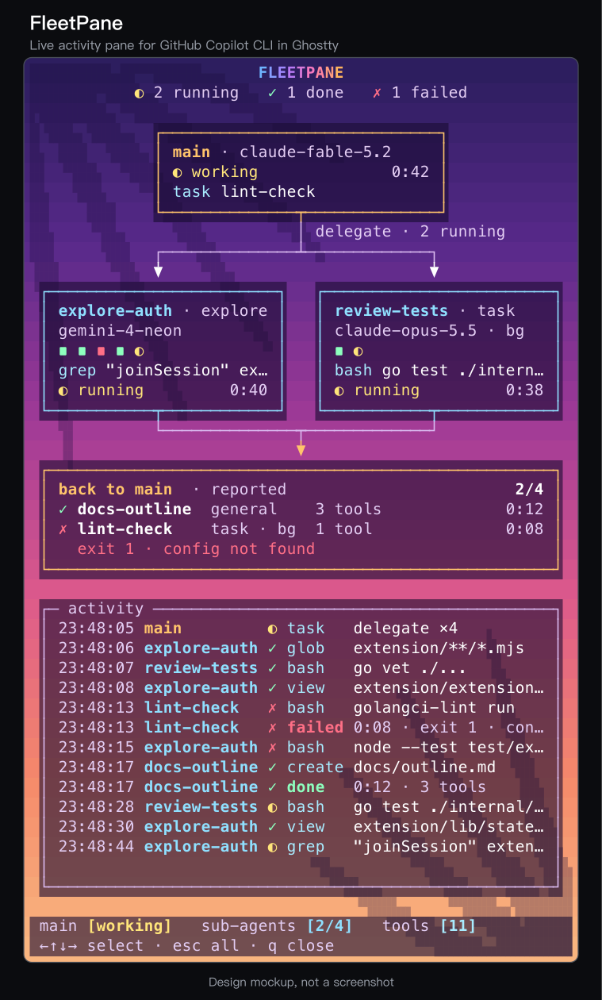

[English](README.md) | 简体中文

# FleetPane

FleetPane 是 GitHub Copilot CLI 的终端活动面板。在 Ghostty 里照常运行 `copilot`，提交第一条提示词后，当前标签页自动分出一个窗格，实时显示主 agent、它的子 agent（比如 `/fleet` 启动的那些）、各自的工具调用和一份活动流水。



设计效果图，不是实际截图

## 它做什么、不做什么

它是什么：

- 只是一个 Copilot CLI 扩展。安装的全部文件都在 `~/.copilot/extensions/fleetpane/` 下：扩展本身（Node）、一个驱动 Ghostty 的 AppleScript、面板程序（Go 写的 TUI）。它不是 `copilot plugin` 的市场插件。
- 只读旁观。它只监听会话的事件，不注册工具，不注册 hook，不改提示词，不注入上下文，不发送消息，也不做权限决定。因为没有注册 hook，CLI 加载它时不会要求提升权限。面板同样只读，不能从面板操作 agent。
- 对 Copilot 唯一可见的新增是一个斜杠命令 `/fleetpane`。
- 不改 CLI 的配置。它不写 `~/.copilot/settings.json`，不动 CLI 本体、其他扩展和插件。
- 默认不留历史。面板显示的数据只在扩展进程的内存里，会话结束就没了。唯一的例外是你自己打开的 2 级调试日志（见[排障](#排障)）。

不做的事：

- 其他终端、在 tmux 里运行、Linux、Windows。
- `copilot -p` 非交互模式：不开面板。
- 会话恢复或扩展重载之后回填之前的事件：面板从空白开始。
- 浮动窗格或只占一角的窗格；记住拖动分隔线之后的比例。
- 后台 shell（`/tasks` 会列出它们，面板只显示 agent）、token 用量和费用、真实的进度百分比（方框里用工具调用的轨迹代替）。
- agent 等你时响铃或发系统通知；空闲一段时间后自动收起面板。
- 用图片做主题背景。
- 扩展和面板程序之间的版本检查。

## 环境要求

- Apple Silicon 上的 macOS
- Ghostty 1.4.0 或更高版本，并开启 AppleScript 支持（`macos-applescript = true`，默认就是开启的）
- GitHub Copilot CLI，并开启实验功能（见下文）。已在 Copilot CLI 1.0.115 上做过完整验收，并在 1.0.116 上做过安装和冒烟测试
- Go 1.26.1 或更高版本，从源码构建或制作安装包时用。用安装包安装不需要 Go

CLI 会自动更新，FleetPane 不锁定 CLI 的版本；它的行为是对着上面这两个版本核对的。扩展跑在 CLI 自带的 Node 运行时上，所以只有做开发才需要另装 Node.js。

没有 CI，也没有公开发布的版本：从源码构建，或者用 `make dist` 做一个安装包，拷到要安装的机器上。

## 安装

### 从源码安装

```sh
git clone https://github.com/biohazard-requiem/copilot-fleetpane.git
cd copilot-fleetpane
make install
```

`make install` 先构建 `bin/fleetpane`，再把扩展复制到 `~/.copilot/extensions/fleetpane/`（设置了 `COPILOT_HOME` 时是 `$COPILOT_HOME/extensions/fleetpane/`）：

```
~/.copilot/extensions/fleetpane/
├── extension.mjs
├── ghostty-split.applescript
├── lib/*.mjs
├── bin/fleetpane
├── themes/        自定义主题放这里；首次安装时会放入 example.json
└── config.json    第一次用 /fleetpane 改设置时生成
```

升级时再执行一次，然后新开一个 Copilot 会话。已有的 `config.json` 和 `themes/` 里已有的文件不会被覆盖。二进制的替换是原子的，正在运行的面板不受影响。

### 用安装包安装

`make dist` 生成 `dist/fleetpane-<版本>-darwin-arm64.tar.gz`，例如 `make dist VERSION=0.1.0`；不带 `VERSION` 时版本是 `dev`。包里是首次 `make install` 放进去的那些文件，外加许可证，都在一个顶层目录 `fleetpane/` 下。安装的机器上不需要 Go，也不需要这个仓库：

```sh
mkdir -p ~/.copilot/extensions
tar -xzf fleetpane-0.1.0-darwin-arm64.tar.gz -C ~/.copilot/extensions
```

解压后得到 `~/.copilot/extensions/fleetpane/`。设置了 `COPILOT_HOME` 时，解压到 `$COPILOT_HOME/extensions`。然后开启实验功能（下一节），新开一个 Copilot 会话。

- 升级时用同样的办法解压新的安装包。`config.json` 和你自己的主题文件会保留，`themes/example.json` 会被覆盖。用 `tar --safe-writes -xzf …` 时每个文件的替换是原子的，和 `make install` 一样，正在运行的面板不受影响。
- 二进制没有经过 Apple 公证。用浏览器下载的安装包带有 macOS 的隔离属性，`tar` 会把它带到解压出来的文件上，macOS 可能因此拒绝运行这个二进制，这时面板打不开。把二进制上的这个属性去掉即可：`xattr -d com.apple.quarantine ~/.copilot/extensions/fleetpane/bin/fleetpane`。用 `scp` 拷贝或用 `curl` 下载的安装包没有这个属性。

## 开启实验功能（一次性）

```sh
copilot config experimental on
```

CLI 只有在实验功能开启时才加载扩展。这是 CLI 的全局设置，会同时启用 CLI 的其他预览功能。要关闭：

```sh
copilot config experimental off
```

FleetPane 不会改动这个设置，安装和卸载时都不会。

## 确认已加载

新开一个 Copilot 会话，执行 `/extensions manage`，列表里应该有 `fleetpane`。整个扩展的停用和启用也在这个界面里。

## 使用

在 Ghostty 里照常运行 `copilot`。

- 启动后只有一个窗格。提交第一条提示词后，当前标签页分屏（默认在右侧，占 33%），面板出现。键盘焦点留在 Copilot 窗格。
- 分屏出现在运行这个 Copilot 会话的标签页里；这个标签页在后台、Ghostty 不是前台应用时也一样。选中的标签页和最前的窗口都不变。
- 后续的提示词复用同一个面板。
- 新的一轮从这两种提示词开始：agent 空闲时提交的提示词（包括 `/fleet …`），以及排队的提示词真正开始执行的那一刻。agent 工作途中发出的消息（插话，steering）并入当前这一轮。`/fleetpane` 本身不会开始新的一轮。
- 手动关掉面板之后，这一轮剩下的时间里它保持关闭：后台事件和插话都不会让它重新出现。下一轮开始时它重新打开。
- 窗口太小（面板会不足 24 列或 6 行）时不开面板，也不输出任何提示；每一轮开始时重新判断。面板开得出来但很小时，显示成紧凑列表，不画工作流节点图。
- Copilot 退出或扩展重载时，面板随之关闭。
- 开面板的过程在后台进行，不会拖住 Copilot。连续两次失败后，FleetPane 在这个会话里不再自动开面板，并在时间线上提示一次；执行 `/fleetpane on` 可以重试。
- 不在 Ghostty 里、不在 macOS 上，或者是 `copilot -p` 的一次性运行时，FleetPane 什么都不做，也不输出任何内容。

## 按键和鼠标

面板有键盘焦点时才收得到按键。面板打开时焦点留在 Copilot 窗格，所以要先把焦点移过去：点一下面板，或者用 Ghostty 切换窗格的快捷键。

| 按键 | 作用 |
| --- | --- |
| `tab` / `shift+tab`、`down` / `up`、`j` / `k`、`right` / `left`、`l` / `h` | 选中下一项 / 上一项：`main`、运行中的子 agent、`back to main` 里的条目。选中某一项时，`activity` 只显示它的记录 |
| `esc` | 取消选中，`activity` 回到显示全部。紧凑布局下先从活动记录页返回 |
| `enter` | 仅紧凑布局：进入选中项的活动记录页。没有选中项时先选中第一项 |
| `pgup` / `pgdown` | `activity` 翻一页 |
| `end` | 跳到最新的记录，并恢复跟随新记录 |
| `q`、`ctrl+c` | 关闭面板 |

| 鼠标 | 作用 |
| --- | --- |
| 滚轮 | 滚动指针所在的那个框：运行区、`back to main`、`activity` 或紧凑列表。不改变选中项 |
| 左键点击 | 选中指针下面的那一项：`main` 方框、某个子 agent 的方框或那一行、`back to main` 里的某一条 |

- 面板接管了鼠标。要在面板里拖选文字，需要按住 Shift（Ghostty 默认的 `mouse-shift-capture = false` 下）。
- 点击面板会把键盘焦点移到面板上，Ghostty 对任何窗格都是这样。要回到 Copilot，点一下它的窗格，或者用 Ghostty 切换窗格的快捷键。只想看看、不想移动焦点时，用滚轮。
- 键盘焦点不在面板上时滚轮同样有效，而且不会移动焦点。
- 面板启动后的前 500 毫秒忽略按键和鼠标事件。分屏出现的那一瞬间敲下的键可能落进新窗格，不该因此把面板关掉。

## 开关与布局

| 命令 | 效果 | 输出 |
| --- | --- | --- |
| `/fleetpane`、`/fleetpane status` | 不保存任何东西 | `FleetPane: on · layout right 33% · theme gta6 · pane open` 和一行用法。最后一段是 `pane open`、`pane closed` 或 `disabled (<原因>)`；本会话的 `hide` 或 `show` 生效时，后面多一段 `· this session: hidden` 或 `· this session: shown` |
| `/fleetpane on` | 保存 `enabled: true`，对所有会话生效。清掉本会话的 `hide` / `show` 和停用状态。面板没开就立即打开，已经开着或正在开时不重复分屏 | `FleetPane: on · layout right 33% · theme gta6` |
| `/fleetpane off` | 保存 `enabled: false`，对所有会话生效。清掉本会话的 `hide` / `show`。立即关闭面板 | `FleetPane: off` |
| `/fleetpane hide` | 只管当前会话，不写配置。立即关闭面板，之后本会话不再自动打开 | `FleetPane: hidden in this session` |
| `/fleetpane show` | 只管当前会话，不写配置。立即打开面板，全局开关是关的时候也开；之后本会话每一轮照常自动打开 | `FleetPane: shown in this session` |
| `/fleetpane layout` | 不保存任何东西 | 当前布局和一行用法 |
| `/fleetpane layout <right\|left\|top\|bottom> [10-80]` | 保存布局。面板开着时，关闭后按新布局重新打开 | `FleetPane: layout top 33%` |
| `/fleetpane theme` | 不保存任何东西 | 当前主题和可用的主题列表 |
| `/fleetpane theme <name>` | 保存主题。面板即时换主题，不需要重开 | `FleetPane: theme auto` |
| `/fleetpane help` | 不保存任何东西 | 一行用法 |

```
Usage: /fleetpane on|off|hide|show|layout <right|left|top|bottom> [10-80]|theme [name]|status|help
```

- 比例是面板占分屏前 Copilot 窗格的百分比：`right` / `left` 按列数算，`top` / `bottom` 按行数算。可以带 `%`。不写比例时保持当前的值。数字先四舍五入，再看是不是在 10 到 80 之间（所以 `9.9` 按 10 接受）；不在范围内或不是数字时报错，不保存。
- `on` 或 `show` 发起了开面板、而窗口太小开不了时，输出是 `FleetPane: window too small (pane would be <列>x<行>, needs 24x6)`。开关照样已经保存。
- 命令的输出只显示在时间线上，不进入会话历史。
- `on` / `off`、布局和主题是所有会话共用的一份配置。在一个会话里改了开关或主题，其他会话在各自的下一轮开始时生效；改了布局，其他会话在下一次开面板时才用新的，已经开着的面板留在原处。
- 每条 `/fleetpane` 命令，包括只查看的那几条，都会先重读配置。开关已经在别的会话里关掉时，本会话的面板这时就会收起。
- `hide` / `show` 只属于一个会话，不写进配置。`/clear` 之后仍然有效；在这个会话里执行 `on` 或 `off` 会清掉它。

四层开关，由外到内：

| 层 | 方式 | 作用 |
| --- | --- | --- |
| CLI 的前提 | `copilot config experimental on` / `off` | CLI 是否加载扩展 |
| 整个扩展 | 在 `/extensions manage` 里停用 `fleetpane` | 扩展不加载，`/fleetpane` 命令也没有了 |
| 开不开面板 | `/fleetpane off` / `/fleetpane on` | 扩展仍然加载，只是不开面板。所有会话共用 |
| 当前会话 | `/fleetpane hide` / `/fleetpane show` | 只管这一个会话。`show` 能盖过 `off` |

### 配置文件

`~/.copilot/extensions/fleetpane/config.json`，第一次用 `/fleetpane` 改设置时生成：

```json
{
  "enabled": true,
  "layout": {
    "position": "right",
    "size": 33
  },
  "theme": "gta6"
}
```

| 字段 | 取值 | 默认 | 无效时 |
| --- | --- | --- | --- |
| `enabled` | 布尔 | `true` | 按 `true` |
| `layout.position` | `right`、`left`、`top`、`bottom` | `right` | 用默认值 |
| `layout.size` | 10 到 80 的整数 | `33` | 不是数字：用默认值。越界：收到最近的边界。小数四舍五入 |
| `theme` | `auto`、`gta6`，或自定义主题的名称 | `gta6` | 不是合法的主题名时用默认值 |

文件不存在或不是合法 JSON 时全部用默认值。未知字段被忽略，保存时也不保留。每一轮开始时和每次执行 `/fleetpane` 命令时都会重新读这个文件，所以也可以手工编辑。

### 分隔线

配置的比例只在面板打开时应用一次。之后可以拖动分隔线：面板按新的尺寸重排，FleetPane 不会把分隔线改回去。拖出来的比例不会被记住，下次打开用的还是配置里的值。Ghostty 自己把分屏比例限制在 10% 到 90% 之间。

## 主题

内置两个主题：

- `gta6`（默认）给整个面板上色：从深紫到橙色的日落渐变底，两个角上有棕榈剪影，方框用压暗的底色。
- `auto` 不画底色，所有颜色都取自终端：默认前景色，次要文字用 faint 属性，其余用 ANSI 调色板里的颜色。它跟随终端的主题，并且每 2 秒查一次终端的背景色，在深色和浅色两组颜色之间切换。

`/fleetpane theme <name>` 即时切换；`/fleetpane theme` 列出可用的主题。

`gta6` 是受那套配色启发的原创配色主题，与游戏的权利方无关，不含任何游戏素材：没有 logo，没有字标，没有原画。剪影是用算法画出来的通用棕榈叶。

### 自定义主题

在 `~/.copilot/extensions/fleetpane/themes/` 下放一个 `<name>.json`。文件名就是主题名：1 到 32 个字符，只能用 `a-z`、`0-9`、`-`、`_`，以字母或数字开头。`auto` 和 `gta6` 永远指内置主题。安装时会放入一份 `example.json`：

```json
{
  "colors": {
    "fg": "#e6edf3", "dim": "#8b949e", "edge": "#3d444d", "main": "#bc8cff", "agent": "#58a6ff",
    "run": "#d29922", "ok": "#3fb950", "fail": "#f85149", "tool": "#79c0ff", "live": "#58a6ff"
  },
  "title": ["#58a6ff", "#bc8cff"],
  "background": { "stops": ["#0d1117", "#161b22"] },
  "glass": { "color": "#010409", "alpha": 0.5 },
  "decor": "none"
}
```

| 颜色 | 用在哪里 |
| --- | --- |
| `fg` | 正文 |
| `dim` | 次要文字：类型、时间、标签、提示 |
| `edge` | 没有选中、也不在活动的边框和连线 |
| `main` | 主 agent 的名称和方框、汇合线、`back to main` |
| `agent` | 运行中子 agent 的名称和方框、`activity` 里的子 agent 名称 |
| `run`、`ok`、`fail` | 运行中、成功、失败的图标和状态文字 |
| `tool` | 工具名 |
| `live` | 活动的连线、箭头和流动的圆点 |

颜色有四种写法：`"#rrggbb"`、`"ansi:N"`（N 为 0 到 15，取终端调色板）、`"default"`（终端的默认前景色）、`"faint"`（默认前景色加 faint 属性）。

| 规则 | 说明 |
| --- | --- |
| 所有字段都可选 | 没写的颜色取 `auto` 主题里对应的值，并和 `auto` 一样随终端的深浅换色。文件里写了的颜色原样使用 |
| 没有 `background` | 不画底色，和 `auto` 一样跟随终端。这时 `glass` 和 `decor` 不起作用 |
| `background.stops` | 一个或多个 `#rrggbb` 颜色，从上到下。有底色时所有颜色都应写成 `#rrggbb`，否则可读性没有保证 |
| `glass` | 方框、活动流水的框和状态栏后面的那层混色：一个颜色和一个 0 到 1 的 `alpha`。有底色而没写 `glass` 时是 `#000000`、0.5 |
| `decor` | `"none"`（默认）、`"palms"`，或 `{ "kind": "palms", "color": "#rrggbb", "alpha": 0.3 }`，`alpha` 为 0 到 1。没写的字段取 `gta6` 的值：`#190b38`、0.30 |
| `title` | 一个颜色，或一个颜色数组（做成渐变）。默认用 `main` 的颜色 |
| 文件 | 必须是普通文件（不能是符号链接），不超过 64 KiB |
| 出错 | JSON 不合法、颜色写法不对、字段类型不对：整个主题不用。面板回退到 `gta6`，并在状态栏末尾说明原因，例如 `theme <name> not found` |
| 不支持 | 背景图片 |

扩展只检查主题名的格式，不检查主题是否存在：`/fleetpane theme <name>` 会把名称存下来，面板加载不了时按上面说的方式提示。

## 面板上显示什么

| 区域 | 内容 |
| --- | --- |
| 标题和计数 | `FLEETPANE`，然后是本轮子 agent 的计数：`◐ N running  ✓ N done  ✗ N failed`；有子 agent 在等你时多一段 `! N waiting`，有被取消的时多一段 `⊘ N cancelled`。没有子 agent 时写 `no sub-agents this turn` |
| `main` 方框 | 主 agent：`main · <模型>`、状态和耗时、当前或最近的工具 |
| 运行区 | 此刻正在运行的子 agent，每个一个方框：名称和类型、模型（后台子 agent 加 `· bg`）、工具调用的轨迹、当前或最近的工具、状态和耗时。轨迹里每次已结束的调用是一个 `■`，颜色表示成功或失败，正在运行的那次是转圈图标 |
| `back to main` | 本轮已经结束的子 agent，每个一行：状态、名称、类型、工具调用数、耗时。失败的下面再加一行错误信息。标题行右侧是 `已结束数/总数` |
| `activity` | 活动流水，新的在下面：时间、发起者、状态、工具名和一句摘要。保留最近 200 条。选中某一项时只显示它的记录 |
| 状态栏 | `main [状态]  sub-agents [运行中/本轮总数]  tools [本轮工具调用数]`，以及按键提示 |

- "本轮的子 agent"指正在运行的，加上本轮之内结束的。上一轮启动、现在还在跑的后台子 agent 也算在内。
- 子 agent 一结束，它的方框就从运行区消失，结果列进 `back to main`。新的一轮开始时这个列表清空，插话不会清空它。更早的结果只留在 `activity` 里。
- 由另一个子 agent 启动的子 agent 紧跟在它的父后面，并标上 `↳`。有地方时写出父的名称（`↳ <父>` 或 `<子> ‹ <父>`）。选中子时父会高亮，框的标题变成 `activity · <子> ‹ <父>`。
- 耗时写成 `m:ss`，满一小时后写成 `h:mm:ss`。

状态图标：

| 图标 | 含义 |
| --- | --- |
| `◐ ◓ ◑ ◒`（转圈） | 运行中、工作中 |
| `!` | 在等你 |
| `✓` | 已完成、成功 |
| `✗` | 失败 |
| `⊘` | 已取消 |
| `○` | 空闲 |
| `?` | 未知状态 |

### 等待状态

agent 停下来等你的时候，它的方框上显示 `!` 和下面两种文字之一，你回应之后消失：

- `needs approval`：agent 在等你批准计划。
- `needs answer`：agent 向你提了一个问题，或者某个 MCP 服务要你填写信息。

在等你的子 agent 仍然留在运行区，计数里算在 `! N waiting` 下面。主 agent 在等时，状态栏写 `main [waiting]`。MCP 服务发起的请求不对应某一次工具调用；事件里没有指明是哪个子 agent 时，它标在 `main` 上。

工具调用的权限确认不在其中，见[已知限制](#已知限制)。

### 布局

布局只看面板实际的尺寸，不看配置里的位置：

| 面板尺寸 | 布局 |
| --- | --- |
| 至少 30 行、40 列 | 纵向工作流：`main`、运行区、`back to main`、`activity`，从上到下 |
| 否则，至少 14 行、147 列 | 横向工作流：同样的内容，从左到右 |
| 其他 | 紧凑列表：一项一行。`enter` 进入选中项的活动记录页，`esc` 返回 |

举例：在 170×45 的窗口里，`right 33%` 的面板约 57×45，用纵向工作流；`bottom 33%` 的面板约 170×15，用横向工作流。

### 子 agent 很多时

运行中的子 agent 没有数量上限。一个都不会被丢掉，也不会折成一个 `+N`；每一个都看得到、选得中。运行区取下面第一种放得下全部子 agent 的形态：

1. 完整方框
2. 矮方框，去掉第二行和工具轨迹（只有纵向工作流有）
3. 紧凑行：一个标题为 `running · N` 的框，每个子 agent 一行
4. 紧凑行加滚动

`activity` 始终显示。运行区、`back to main`、`activity` 和紧凑列表放不下时都可以滚动；框的边线上用 `▲ N`、`▼ N` 标出上方和下方没显示的数量。在 57×45 的面板里，`back to main` 还没有条目时：6 个以内是完整方框，7 到 8 个是矮方框，9 到 40 个是紧凑行，再多就滚动。

## 首次的 macOS 自动化授权

FleetPane 通过 `osascript` 控制 Ghostty。第一次使用时，macOS 可能会问是否允许控制 Ghostty。测试期间没有出现过这个提示；无法确定是之前已经授权过，还是本来就不需要。

被 macOS 拒绝时，FleetPane 提示一次，并在这个会话里不再开面板：

```
FleetPane: macOS did not allow control of Ghostty. Allow it in System Settings → Privacy & Security → Automation, then run /fleetpane on.
```

也就是到"系统设置 → 隐私与安全性 → 自动化"里允许，然后执行 `/fleetpane on`。

授权提示挂着的时候 Copilot 照常工作。分屏在后台进行，20 秒后放弃。

## 关闭面板

| 方式 | 效果 |
| --- | --- |
| 在面板里按 `q` 或 `ctrl+c` | 立即关闭，不需要确认。这一轮剩下的时间里面板保持关闭，下一轮开始时重新打开 |
| 对面板使用 Ghostty 自己的关闭动作（`close_surface`，比如它的快捷键） | 面板里还有进程在运行，所以 Ghostty 会弹出 `Close Terminal?` 确认框（Ghostty 默认 `confirm-close-surface = true`）。确认之后效果同 `q`，只是 FleetPane 要晚大约 5 秒才知道面板关了（见[已知限制](#已知限制)） |
| `/fleetpane hide` | 关闭面板。本会话不再打开它，直到执行 `show`、`on` 或 `off` |
| `/fleetpane off` | 关闭面板。在执行 `on` 之前，所有会话都不再开面板，自己执行了 `show` 的会话除外。其他会话在各自的下一轮开始时生效 |
| 在 `/extensions manage` 里停用 `fleetpane` | 扩展被停掉，面板随之关闭。重新启用之前没有 `/fleetpane` 命令 |
| `/exit`，或者其他让扩展结束或重载的操作 | 面板随扩展一起关闭 |

对于带着命令创建的窗格，命令退出之后 Ghostty 会把窗格留着，按任意键才关。所以面板程序在退出之前自己关掉所在的窗格。面板程序没来得及这样做就被杀掉时，由扩展来关；连扩展也不在了的话，会留下一个空窗格，按任意键就能关掉。

## 工作方式

```
Copilot CLI (tty X)
     ^
     |  JSON-RPC / stdio
     v
extension.mjs  ----  osascript ghostty-split.applescript  ---->  Ghostty
（Node，CLI 的子进程）                                              |
     |                                                  把 tty 为 X 的终端分屏，
     |  Unix socket                                     在新窗格里运行 fleetpane
     |  （扩展是服务端）                                            |
     |                                                              v
     +----------------------------------->  fleetpane（Go TUI，socket 客户端）
```

扩展接入会话，把会话的事件归并成一份很小的状态：主 agent、子 agent、它们的工具调用和活动流水。新的一轮开始时，它沿父进程找到 Copilot 的 TTY，在自己的一个 Unix socket 上开始监听，然后运行一个 AppleScript，让 Ghostty 把这个 TTY 对应的终端分屏、在新窗格里运行 `fleetpane`，并把焦点还回去。`fleetpane` 连上 socket，收到一份快照就画一次：每行 JSON 是一份完整的快照，最多每 50 毫秒一份。Ghostty 的分屏总是对半分，所以扩展随后量出 Copilot 窗格的尺寸，把分隔线移到配置的比例。

由扩展做服务端，是为了让面板不会比扩展活得久：扩展进程不管怎样结束，连接都会断开，`fleetpane` 随即关掉自己的窗格并退出。每个会话有自己的扩展进程和自己的 socket，会话之间看不到彼此的数据。

数据存在哪里：

- 面板显示的数据只在扩展进程的内存里，会话结束就没了，不写任何历史。设置了 `FLEETPANE_DEBUG=2` 时除外：每一份快照都会写进调试日志。
- 保留的历史有上限：活动记录 200 条，每个 agent 的工具调用 20 条，更早的轮次里结束的子 agent 50 个。正在运行的子 agent 全部保留。
- 快照里有名称、状态、时间、每次工具调用的一句摘要（命令、路径、URL）和错误信息的第一行，不包含工具的结果。

磁盘上只有三样东西：

| 文件 | 什么时候有 | 什么时候没 |
| --- | --- | --- |
| 扩展目录下的 `config.json` | 用 `/fleetpane` 改过设置之后 | 卸载时 |
| 运行时目录里的 socket 和本会话的 `hide` / `show` 标记 | 面板正在打开或开着时；执行过 `hide` 或 `show` 之后 | socket 在面板关闭或扩展进程退出时删除。没来得及删的 socket、Copilot 进程已经不在的标记，由下一个启动的扩展或 `make uninstall` 清掉 |
| 运行时目录里的调试日志 | 只有设置了 `FLEETPANE_DEBUG` 才有；每个文件写到约 20 MiB 就停 | 写它的进程不在之后，由下一个启动的扩展或 `make uninstall` 清掉 |

运行时目录是 `/tmp/fleetpane-<uid>/`，只有属主可以访问。

## 排障

面板没出现时，依次检查：

1. 环境。FleetPane 只在 macOS 的 Ghostty 里、不在 tmux 里、交互式会话中开面板。其他情况下它有意保持安静。
2. 实验功能：执行 `copilot config experimental on`，然后新开一个会话。
3. 扩展：`/extensions manage` 的列表里有 `fleetpane`，而且没有被停用。`/fleetpane` 不是已知命令，说明扩展没有加载。
4. 开关：执行 `/fleetpane`，看第一行。`off`、`this session: hidden`、`disabled (<原因>)` 都说明了面板为什么没开；`/fleetpane on` 会把这三种都清掉并尝试打开面板。

   | 原因 | 含义 |
   | --- | --- |
   | `not-interactive` | `copilot -p` 的一次性运行 |
   | `unsupported-platform` | 不是 macOS |
   | `unsupported-terminal` | 设置了 `TERM_PROGRAM`，而且不是 `ghostty` |
   | `no-tty` | 找不到 Copilot 所在的终端 |
   | `not-running`、`not-found` | Ghostty 没有在运行，或者里面没有 Copilot 的 TTY 对应的终端 |
   | `install-incomplete` | `bin/fleetpane` 不存在或不可执行：重新执行 `make install`，或者把安装包再解压一次 |
   | `unauthorized` | macOS 不允许控制 Ghostty |
   | `failed` | 连续两次打开失败。用下载的安装包装的话，先确认 macOS 肯运行这个二进制：`~/.copilot/extensions/fleetpane/bin/fleetpane --version`（见[用安装包安装](#用安装包安装)） |

5. 窗口尺寸：`/fleetpane on` 回答 `window too small` 时，把窗口拉大，或者换一种布局。
6. 每条命令的回答都是 `FleetPane unavailable: <原因>`，说明扩展没能完成初始化，比如运行时目录不是一个只有你自己能访问的真实目录。

还找不到原因时，带着调试日志启动 Copilot：

```sh
FLEETPANE_DEBUG=1 copilot
```

扩展会把 JSON 行追加到 `/tmp/fleetpane-<uid>/<会话 ID>.<进程号>.log`：

| 记录 | 内容 |
| --- | --- |
| `boot` | 进程号、Node 版本、扩展目录、运行时目录 |
| `turn` | 新的一轮开始。不记提示词的内容 |
| `pane` | 面板状态的每一次变化和原因，例如 `too-small` |
| `script` | 分屏脚本的每一次调用：动作、参数、耗时、输出或错误 |
| `resize` | 量到的尺寸，以及算出来的分隔线移动量 |
| `client` | 面板程序的连接和断开 |
| `command` | 解析后的 `/fleetpane` 命令 |
| `error` | 出错的位置和消息 |

`FLEETPANE_DEBUG=2` 会把发出的每一份快照也完整地写进日志。快照里有工具调用的摘要，也就是命令、路径和 URL，所以只在需要时才开这个级别。日志文件超过 20 MiB 之后不再增长：越线的那条记录会写完整，后面再跟一条说明。

在启动 `copilot` 的环境里设置 `FLEETPANE_RUNTIME_DIR=<绝对路径>`，可以换一个运行时目录。路径要短：Unix socket 的路径最长约 100 字节。执行 `make uninstall` 时也要带上它。

## 已知限制

面板显示的内容：

- 工具调用的权限确认不显示成等待。出现确认框时 CLI 不会通知扩展，所以等你批准的工具在面板上是运行中；确认框在 Copilot 自己的界面上。
- 子 agent 结束一次运行之后，`/tasks` 把它列为 idle，面板显示已完成。
- 主 agent 追问一个已经结束的子 agent 时，面板重新把它显示成运行中。这样的一次运行没有结束事件：面板根据它最后一轮没有再请求工具来推断它结束了，或者以整个会话进入空闲为准。
- 耗时是墙钟时间，包含 agent 等你的那段时间。`/tasks` 显示的数字可能不一样。
- `/clear`、恢复会话或扩展重载之后，面板从空白开始。

打开和关闭：

- 面板刚出现时是对半分的，约半秒内跳到配置的比例：Ghostty 的分屏不能指定尺寸，FleetPane 只能先量、再移动分隔线。量到的结果会被记住，所以同一个会话里之后再打开只跳一次（实测约 0.13 秒）。`/clear` 之后重新量。某一步量不出来时，面板保持当时的比例。
- 用 Ghostty 的快捷键关闭面板要确认；在面板里按 `q` 不用。
- 用 Ghostty 关掉面板之后，Ghostty 为了让你能撤销关闭，会让窗格里的程序再运行一小段时间（`undo-timeout`，默认 5 秒），FleetPane 要等它结束才知道面板关了。这几秒里开始的那一轮不会重新打开面板，再下一轮照常。按 `q` 关没有这个延迟。
- 面板程序被杀掉、扩展也不在了的时候，会留下一个空窗格。在里面按任意键关掉它。
- `copilot -p` 是靠 Copilot 命令行上的词认出来的。某个参数的值恰好是 `-p` 或 `-i` 时会判断错：这个会话不开面板，或者一次 `-p` 的运行闪一下面板。
- FleetPane 假定 CLI 的沙箱（`sandbox.enabled`）是关的。开启沙箱时扩展进程也在沙箱里，`osascript` 或 `/tmp` 可能用不了。

显示：

- Ghostty 会把没有焦点的窗格调暗（`unfocused-split-opacity`，默认 0.7），而面板通常没有焦点，所以颜色比效果图暗。想要原色，在 Ghostty 的配置里设 `unfocused-split-opacity = 1`；这是 Ghostty 的全局设置。
- 环境里设了 `RUNEWIDTH_EASTASIAN=1` 时，面板用来画图的符号会被算成两格宽，布局会错位。不设时它们都是一格宽，中日韩的区域设置下也一样。
- `auto` 主题用的是终端的 ANSI 颜色。某个颜色在你的终端主题下看不清时，换用自定义主题。

鼠标：

- 面板接管了鼠标，所以拖选文字要按住 Shift。点击会选中一项，同时把键盘焦点移到面板上，在 Ghostty 里点击任何窗格都是这样。面板没有焦点时的滚轮行为见[按键和鼠标](#按键和鼠标)。

运行时目录：

- macOS 会清理 `/tmp` 下几天没动过的文件。某个会话的 `hide` / `show` 标记被清掉之后，这个会话在下一次 `/clear` 之后回到跟随全局开关，直到再执行一次 `hide` 或 `show`。
- 执行 `make uninstall` 时还开着的会话，退出时会留下自己的标记和日志，因为已经没有扩展来清理它们。之后再执行一次 `make uninstall`，或者等系统清理 `/tmp`。

## 卸载

```sh
make uninstall
```

- 删除 `~/.copilot/extensions/fleetpane/`，包括 `config.json` 和你的自定义主题。
- 清掉运行时目录里进程已经不存在的 FleetPane 文件（socket、日志、标记）；目录空了就一并删除。
- 不会改动 `experimental`。要关闭它：`copilot config experimental off`。
- 还开着的会话在退出时会删掉自己的 socket。它留下的标记和日志，在它退出之后再执行一次 `make uninstall` 清掉，或者等系统清理 `/tmp`。
- 卸载时还开着的面板会继续显示它的会话，但会话结束时它没法再自己收起：它用来收起的脚本已经被删掉了。在留下的窗格里按任意键关掉它，或者在卸载之前先把面板关掉（`q`）。

用安装包装的、手边没有仓库时：`rm -rf ~/.copilot/extensions/fleetpane`。它同样会删掉 `config.json` 和你的自定义主题，上面关于还开着的面板的说明也同样适用。各个会话留在运行时目录里的文件等系统清理 `/tmp` 时消失。

## 开发

```sh
make build   # go build -trimpath -o bin/fleetpane ./cmd/fleetpane
make test    # go test ./... 和 node --test test/extension/*.test.mjs
make vet     # go vet ./...，并对每个 .mjs 执行 node --check
make dist    # dist/fleetpane-<版本>-darwin-arm64.tar.gz，见“安装”
```

`hack/replay.mjs` 把一份录下来的事件文件经扩展的状态归并和 socket 服务端回放给面板程序，不需要 Copilot：

```sh
node hack/replay.mjs test/testdata/fleet-two-agents.jsonl
# 它会打印 socket 路径和要执行的命令；在另一个终端里：
./bin/fleetpane --socket <path>
```

```
usage: node hack/replay.mjs <events.jsonl> [--step-ms <n>] [--pause-at <n>[,<n>...]]... [--theme <name>]
```

回放会等面板连上之后才开始，每隔 `--step-ms` 毫秒（默认 150）喂一条事件。`--pause-at` 让它在播完指定的事件后停住，按回车或发送 `SIGUSR1` 后继续。播完之后保持监听，`ctrl+c` 退出。

```
fleetpane --socket <path> [--themes <dir>] [--close-pane <script>]
```

`--themes` 是自定义主题的目录。`--close-pane` 由扩展传入，让程序在退出时关掉自己所在的 Ghostty 窗格；手工运行时不要带它。

| 路径 | 内容 |
| --- | --- |
| `cmd/fleetpane`、`internal/` | 面板程序 |
| `extension/` | 扩展，原样安装 |
| `hack/` | 安装、卸载和打包脚本、回放、处理事件样例的工具 |
| `test/extension/`、`test/testdata/` | 扩展的测试和事件样例 |
| `test/e2e/` | 在 Ghostty 里对着真实 CLI 做测试用的驱动。不安装 |
| `docs/design/` | 设计效果图 |

没有 CI，也没有公开发布的版本。`test/e2e` 里的工具会给自己的测试窗口截图，这需要给终端应用开"屏幕录制"授权（系统设置 → 隐私与安全性 → 录屏与系统录音，旧版本的 macOS 里叫"屏幕录制"）。换一台机器或换一个终端应用，都要重新授权。

## 许可证

MIT，见 [LICENSE](LICENSE)。

FleetPane 是独立项目，与 GitHub 无关，也未获其认可。
